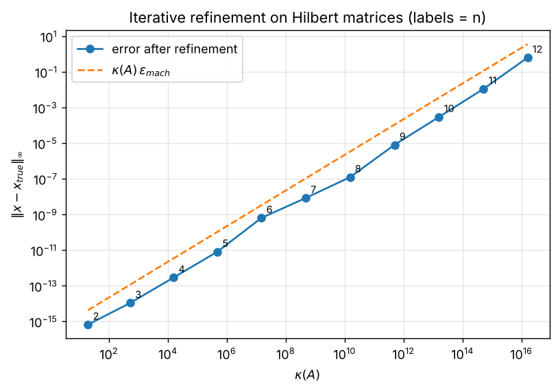
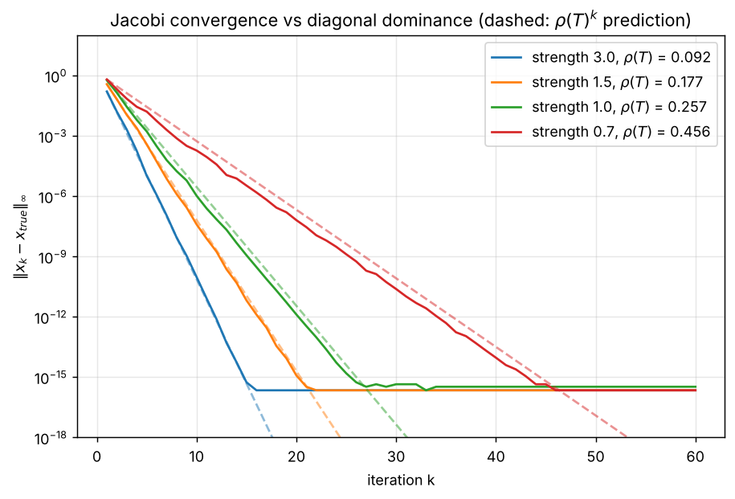
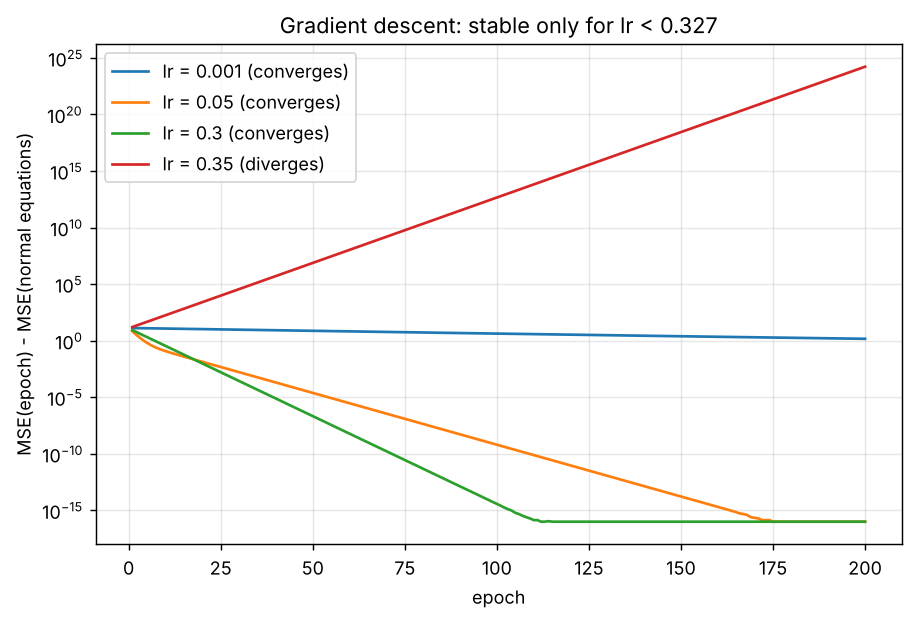

# Numerical Linear Algebra and Regression from Scratch

Direct and iterative solvers for linear systems, plus linear regression, implemented by hand in Python/NumPy. Each method is checked against NumPy, and small experiments show *why* it behaves the way it does: pivoting, conditioning, spectral radius, step-size stability.

Written while studying *Explorations in Numerical Analysis* (Lambers, Sumner Mooney, Montiforte) and *Numerical Linear Algebra* (Trefethen & Bau).

## Contents

| Topic | Code | Experiment |
| --- | --- | --- |
| Diagonal, forward and back substitution | [`linalg/triangular.py`](linalg/triangular.py) | (tests) |
| Gaussian elimination: naive and complete pivoting | [`linalg/gaussian.py`](linalg/gaussian.py) | [`pivoting_failure`](experiments/pivoting_failure.py) |
| LU factorization (Crout) | [`linalg/lu.py`](linalg/lu.py) | (tests) |
| Iterative refinement with stagnation detection | [`linalg/refinement.py`](linalg/refinement.py) | [`hilbert_refinement`](experiments/hilbert_refinement.py) |
| Jacobi, Gauss-Seidel, spectral radius | [`linalg/iterative.py`](linalg/iterative.py) | [`jacobi_convergence`](experiments/jacobi_convergence.py) |
| Linear regression: gradient descent vs normal equations | [`regression/`](regression/) | [`learning_rate_study`](experiments/learning_rate_study.py) |
| inv vs solve vs lstsq on collinear features | [`regression/conditioning.py`](regression/conditioning.py) | [`regression_conditioning`](experiments/regression_conditioning.py) |
| Python loops vs vectorized NumPy | | [`vectorization_benchmark`](experiments/vectorization_benchmark.py) |

## Results

### 1. Naive elimination fails, complete pivoting does not

`python -m experiments.pivoting_failure`

| System | Naive elimination | Complete pivoting | True |
| --- | --- | --- | --- |
| Zero pivot appears after step 1 | `[nan nan nan]` | `[1. 2. 3.]` | `[1, 2, 3]` |
| Pivot 1e-17 | `[0. 1.]` | `[1. 1.]` | `[1, 1]` |

The second case is worse than a crash: no division by zero, just a silently wrong answer. The multiplier 1/1e-17 swamps the other entries, and `1 + 1e-17` rounds to `1`.

### 2. Iterative refinement cannot beat κ(A)·ε

`python -m experiments.hilbert_refinement`

Refinement repeats `r = b - A x`, solves `A e = r`, sets `x = x + e`. It stops when ‖e‖∞ < tol or when ‖e‖∞ stops decreasing (stagnation). On Hilbert matrices, whose condition number grows exponentially with n, the final error tracks κ(A)·ε_mach:



| n | κ(A) | κ(A)·ε | final error | iterations | stop reason |
| --- | --- | --- | --- | --- | --- |
| 4 | 1.6e4 | 3.4e-12 | 2.9e-13 | 2 | converged |
| 6 | 1.5e7 | 3.3e-9 | 6.4e-10 | 3 | stalled |
| 9 | 4.9e11 | 1.1e-4 | 8.1e-6 | 3 | stalled |
| 12 | 1.6e16 | 3.6 | 0.63 | 4 | stalled |

With the residual computed in the same precision, refinement cannot recover digits the conditioning has already destroyed. Detecting stagnation stops it after 3–5 iterations instead of running to `max_iter`.

### 3. Jacobi converges at rate ρ(T)

`python -m experiments.jacobi_convergence`

Jacobi is the linear iteration x_{k+1} = T x_k + c with T = −D⁻¹(L+U). The error obeys e_{k+1} = T e_k, so it converges for every starting point iff ρ(T) < 1, and asymptotically ‖e_k‖ ~ ρ(T)^k. The more diagonally dominant the matrix, the smaller ρ(T):



The dashed lines are the ρ(T)^k prediction, computed from the eigenvalues of T. They match the measured slopes until the error reaches machine precision.

Row order matters too. The same 3×3 system has ρ(T) = 3.81 in its original order, and Jacobi diverges to about 1e58. After swapping two rows, ρ(T) = 0.29 and Jacobi converges to [1, 2, 3] in 21 iterations.

### 4. Gradient descent and the learning-rate limit

`python -m experiments.learning_rate_study`

For y = w x + b with the MSE loss, the Hessian is constant, H = (2/m) XᵀX. Gradient descent is therefore the linear iteration θ_{k+1} − θ* = (I − lr·H)(θ_k − θ*), which is stable iff **lr < 2 / λ_max(H)**. Here that bound is 0.327:



| lr | behaviour | w after 200 epochs | MSE |
| --- | --- | --- | --- |
| 0.001 | converges, very slowly | 1.42 | 1.71 |
| 0.05 | converges | 2.0121 | 0.2310 |
| 0.3 | converges, fastest | 2.0121 | 0.2310 |
| 0.35 | diverges | −7.4e11 | 1.7e24 |
| normal equations | exact | 2.0121 | 0.2310 |

At lr = 0.35, b still converges and only w blows up. Each parameter follows its own eigendirection of H, and only the direction of λ_max is unstable.

### 5. Never form (XᵀX)⁻¹

`python -m experiments.regression_conditioning`

The model is y = 1 + 2·x1 − 3·x2 + noise, with x2 made progressively closer to x1. Forming XᵀX squares the condition number, cond(XᵀX) = cond(X)²:

| Features | cond(X) | cond(XᵀX) | inv: MSE | solve: MSE | lstsq: MSE |
| --- | --- | --- | --- | --- | --- |
| independent | 1.1 | 1.3 | 9.9e-5 | 9.9e-5 | 9.9e-5 |
| x2 = x1 + 1e-4·noise | 2.3e4 | 5.4e8 | 9.6e-5 | 9.6e-5 | 9.6e-5 |
| x2 = x1 + 1e-8·noise | 2.3e8 | ≈ 1/ε | **1.1e-2** | 1.1e-4 | 1.1e-4 |

When the columns are nearly collinear, the individual weights are not identifiable. All three methods return w1, w2 in the thousands, but w1 + w2 ≈ −1, the true value, is recovered by `solve` and `lstsq`. The difference w1 − w2 lies along the smallest singular direction of X, where the data carries no information. The explicit inverse is the only method whose fit quality degrades: 100× higher MSE.

## Running

```bash
python -m venv .venv && source .venv/bin/activate
pip install -r requirements.txt
python -m pytest                          # 21 tests, all checked against NumPy
python -m experiments.hilbert_refinement  # any experiment, run from the repo root
```

Figures are written to `figures/`.

## Layout

```
linalg/        direct and iterative solvers
regression/    gradient descent, normal equations, conditioning
experiments/   one script per result above
figures/       generated plots
tests/         pytest suite
```

The code is deliberately loop-based where the algorithm is the point. NumPy is used for vector operations and as the reference for correctness. Style follows the Linux kernel conventions: tabs, short functions, few comments.
